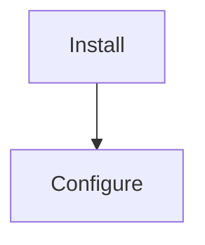

# Markdown elements — the house forms

## Code fences

Every fence names a language. An unlabelled fence loses highlighting and tells the reader nothing about what
they are looking at.

````markdown
```bash
yarn add strata-storage
```

```ts
import { storage } from 'strata-storage';
await storage.set('user', { id: 1 });
```
````

- **Shell blocks show the command, not a transcript.** No `$` prompts (they break copy-paste), no pasted
  output unless the output *is* the point — and then it goes in its own fence labelled `text`.
- Use `jsonc` rather than `json` when the block has comments, or the highlighter marks them as errors.
- Long commands break with `\` at line ends so they stay copy-pasteable.
- A code block inside a list item is indented to the item's content column, or it ends the list.

## Tables

Anything enumerable is a table: options, platforms, error codes, comparisons, file maps. Prose listing four
parallel facts is harder to scan and impossible to skim.

```markdown
| Option | Type | Default | What it does |
|---|---|---|---|
| `ttl` | `number` | `0` | Expiry in ms. `0` never expires. |
```

- Header separator is `|---|---|` — no padding alignment, it churns diffs for nothing.
- Keep cells short; anything needing a paragraph belongs under a heading instead.
- A `Default` column beats repeating "defaults to X" in every description.
- Code-format every identifier: `` `ttl` ``, not ttl.

## Callouts

```markdown
> [!NOTE] Useful context, not essential.
> [!TIP] A better way to do it.
> [!IMPORTANT] The reader will hit a problem without this.
> [!WARNING] Risk of breakage or data loss.
> [!CAUTION] Destructive or irreversible.
```

GitHub and npm style these; **Docusaurus renders them as a plain blockquote** and needs `:::note` … `:::`
instead. See `renderers.md`. Reserve `IMPORTANT` and above for things that genuinely bite — a document where
everything is a warning has no warnings.

## Images

```markdown
/main/assets/logo.svg" alt="<Name> logo" width="120" />
```

- **Alt text always**, describing what it shows — not "image" or "logo.svg".
- **Explicit `width`** so the page does not reflow as it loads and an SVG does not render at some arbitrary
  intrinsic size.
- **SVG master**, raster exported from it only when a target demands raster (per the SVG-first rule).
- **Absolute URL in any package README** — npm renders off-repo and a relative path 404s.
- Centre a header block with `<div align="center">`, which every renderer honours.

## Badges

Shields.io, in one unbroken row directly under the title, in a fixed order so every package looks alike:
version → downloads → license → types → size → CI → node.

```markdown
[](https://www.npmjs.com/package/strata-storage)
[](https://www.npmjs.com/package/strata-storage)
[](./LICENSE)
```

Every badge is a link to what it measures. Badges report facts that update themselves — never a hand-written
"100% coverage" or "production ready" badge, which is a claim, not a measurement, and goes stale silently.

## Lists

- `-` for bullets, always (mixing `-` and `*` churns diffs).
- `1.` for every ordered item — markdown renumbers, and a real `1. 2. 3.` breaks the moment a step is inserted.
- Two-space continuation indent so wrapped lines align under the text.
- A list of more than about seven items is usually a table.
- Task lists `- [ ]` belong in trackers and issues, never in a README — an unticked box in shipped
  documentation reads as an unfinished product.

## Details / collapsible

```markdown
<details>
<summary>Full configuration reference</summary>

Content, blank-line-separated from the summary or it will not render.

</details>
```

Renders everywhere. Good for long option dumps and stack traces; **never** for anything a first-time reader
needs — collapsed content is invisible to someone skimming, and to most search.

## Mermaid

````markdown

````

GitHub and Docusaurus render it; **npm shows the source as a code block**. A diagram that matters to a package
user belongs on the docs site with the README linking to it, or ships as an exported SVG.

## Front matter

Docs-site pages only. `title` and `description` are not optional — without them the page is unsearchable and
ships an empty meta description. `tags` power discovery.

```markdown
---
title: Quick Start
description: Install strata-storage and read and write your first value in under a minute.
tags: [getting-started, installation]
---
```

Internal documents carry `Last Updated: YYYY-MM-DD` instead, as a line near the top rather than front matter.

## Line width and whitespace

Wrap prose near 110 characters so diffs stay reviewable line by line — a single-line paragraph makes every
edit look like a full rewrite. Never wrap tables, code, or link-heavy lines. One blank line between blocks,
never two. No trailing whitespace except a deliberate two-space line break, and prefer restructuring to
needing one.
