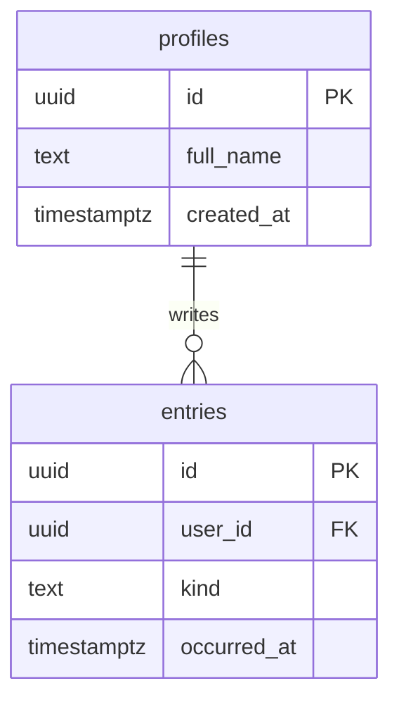

# Design checklist

**Last Updated:** 2026-10-21.

## Every table

- [ ] Plural `snake_case` name; `id uuid primary key default gen_random_uuid()`.
- [ ] `created_at timestamptz not null default now()`; `updated_at` with a trigger when rows change.
- [ ] One owner column (`user_id`, `workspace_id`, …) with a foreign key and an explicit `on delete` choice.
- [ ] RLS enabled; one policy per operation; every list query can prove its policy from its own filters.
- [ ] Grants audited: the default ACL revoked where a column-scoped UPDATE is intended; `TRUNCATE` revoked.
- [ ] An index for every foreign key used in a filter and for each list's sort order.
- [ ] Closed sets as enums; money as integer minor units with a currency column; time as `timestamptz`.
- [ ] Counts and aggregates served by a view, an RPC or a rollup table, never by the client.
- [ ] Listed in `SCHEMA.md` (diagram + table line + change-log row).

## Mermaid shape

Key columns and every FK, not every column. The label on a relation is a verb.

## Migration proof (Firebase → Supabase, gate 2)

- [ ] `grep -rE "firebase|firestore" src/ package.json` → nothing (the Firebase Hosting config is a separate
      hosting decision, `services-integrations.md`).
- [ ] Import counts recorded per entity, in and out, with every difference explained.
- [ ] Sign-in on the migrated app as a migrated non-admin user shows that user's data and nobody else's.
- [ ] The project's RLS/grants gate passes, with an owned and a forbidden row seeded first.
- [ ] Firestore is left read-only and untouched until the owner decides to delete it (an owner decision).
