# WindowSweep database schema

The Drizzle source is `desktop/src/db/schema/*.ts`. `desktop/supabase/migrations/` is the ordered SQL output. The hosted project serves development and production; no migration in this document has been applied by this offline schema pass. The view `latest_app_releases` exposes the latest public release per platform and channel without the publishing admin's id.

## Diagram

```mermaid
erDiagram
  AUTH_USERS ||--|| PROFILES : owns
  AUTH_USERS ||--o| USER_SETTINGS : owns
  AUTH_USERS ||--o{ RUNS : records
  AUTH_USERS ||--o{ CONTACT_REQUESTS : sends
  AUTH_USERS ||--o{ DEVICES : registers
  AUTH_USERS ||--o{ RUN_CLAIMS : may_claim
  AUTH_USERS ||--o{ SUBSCRIPTIONS : buys
  AUTH_USERS ||--o{ CHECKOUT_QUOTES : opens
  AUTH_USERS ||--o{ PLAN_GRANTS : receives
  AUTH_USERS ||--o{ PLAN_REQUESTS : files
  AUTH_USERS ||--o| TEAMS : owns
  AUTH_USERS ||--o| TEAM_MEMBERS : joins
  AUTH_USERS ||--o{ REFERRALS : refers
  AUTH_USERS ||--o| REFERRALS : joins_by_code
  DEVICES ||--o{ RUNS : attributes
  PLANS ||--o{ SUBSCRIPTIONS : pays_for
  PLANS ||--o{ CHECKOUT_QUOTES : quotes
  PLANS ||--o{ PLAN_GRANTS : grants
  PLANS ||--o{ PLAN_REQUESTS : requests
  WEBHOOK_EVENTS ||--o{ BILLING_EMAIL_DELIVERIES : notifies
  TEAMS ||--o{ TEAM_MEMBERS : seats
  TEAMS ||--o{ TEAM_INVITES : invites
  TEAMS ||--o{ SUBSCRIPTIONS : paid_team
  PLAN_GRANTS ||--o| REFERRALS : rewards
  REFERRALS ||--o| REFERRAL_BADGE_AWARDS : awards
  BADGE_CATALOGUE ||--o{ REFERRAL_BADGE_AWARDS : names
  AUTH_USERS ||--o{ REFERRAL_BADGE_AWARDS : earns

  AUTH_USERS { uuid id PK }
  PROFILES { uuid user_id PK text email text platform_role text referral_code }
  USER_SETTINGS { uuid user_id PK jsonb prefs timestamptz settings_updated_at }
  RUNS { text run_id PK uuid user_id FK uuid device_id FK timestamptz started_at }
  CONTACT_REQUESTS { uuid id PK uuid user_id FK text status }
  ADMIN_AUDIT { uuid id PK uuid actor text action timestamptz at }
  DEVICES { uuid id PK uuid user_id FK timestamptz last_seen_at }
  RUN_CLAIMS { uuid id PK uuid device_id uuid user_id FK text month run_pool pool }
  PLANS { text id PK smallint rank boolean is_active }
  APP_CONFIG { text key PK jsonb value boolean is_public }
  PLAN_GRANTS { uuid id PK uuid user_id FK text plan_id FK timestamptz ends_at }
  PLAN_REQUESTS { uuid id PK uuid user_id FK text plan_id FK plan_request_status status }
  SUBSCRIPTIONS { uuid id PK uuid user_id FK text plan_id FK text polar_order_id }
  CHECKOUT_QUOTES { text polar_checkout_id PK uuid user_id FK text plan_id FK }
  WEBHOOK_EVENTS { text id PK text order_id text type }
  BILLING_EMAIL_DELIVERIES { text event_id PK text template PK timestamptz sent_at timestamptz uncertain_at }
  REFERRALS { uuid id PK uuid referrer_id FK uuid invitee_id FK }
  BADGE_CATALOGUE { text key PK text name text family }
  REFERRAL_BADGE_AWARDS { uuid id PK uuid user_id FK uuid referral_id FK text badge_key FK timestamptz awarded_at }
  REFERRAL_VOIDS { uuid id PK text reason_code timestamptz voided_at }
  TEAMS { uuid id PK uuid owner_id FK text name }
  TEAM_MEMBERS { uuid team_id PK uuid user_id PK team_role role }
  TEAM_INVITES { uuid id PK uuid team_id FK text email }
  APP_RELEASES { uuid id PK release_platform platform release_channel channel text version }
```

`run_claims.device_id` deliberately has no foreign key. A forgotten PC or deleted account must not reset that random install id's monthly count. On account deletion, `run_claims.user_id` becomes null and the row keeps no exact timestamp. `admin_audit`, `app_releases`, and `webhook_events` outlive account deletion; they do not store the person's words.

`billing_email_deliveries` is keyed by webhook event and template. A successful paid event and every valid signed return event write a pending mail row in the same transaction. Mail can be claimed separately without reapplying payment. The ledger stores no address or user id. A return before its paid event resolves the recipient from the signed Polar subscription id and an earlier paid period, or from the signed checkout id and its quote. If neither resolves to a live profile, the row becomes `recipient_missing`. Unknown send outcomes and unresolved claims block retry until an admin checks the FilesHub job and reconciles them; `unavailable` is terminal.

Welcome, referral, team-invite and plan-request emails use claim tokens with no automatic expiry. A confirmed queued send stamps success; a definitive refusal releases the claim. An unknown FilesHub outcome stamps an indexed uncertain time and blocks automatic retry. If that stamp itself fails, the unresolved claim still blocks retry. An admin checks the FilesHub job, then uses `admin_email_reconcile` to mark sent or permit retry; `admin_email_uncertain_list` pages both uncertain and stale claimed cases.

## Tables

| Table | Purpose and owner | RLS and expected size |
|---|---|---|
| `profiles` | One row per auth identity; `user_id`. Device sessions have null email and referral eligibility time until Google conversion. | Own read, admin read, display-name-only update. One per user. Welcome mail has a token-checked send lease and an indexed uncertain state. |
| `user_settings` | Cross-device preferences; `user_id`. | Own signed-in read/write. One per account. |
| `runs` | Synced run summaries; `user_id`. | Own signed-in read/insert/delete. Grows with runs; `(user_id, started_at)` index. |
| `contact_requests` | Support messages; `user_id`. | Own signed-in insert/read; admin triage. Small per account, indexed by owner and status. |
| `admin_audit` | Append-only administrative and system record; no row owner. | Admin read, definer write. Grows with changes; indexed by time and subject. |
| `devices` | Random install ids and last-seen stamps; `user_id`. | Own read/delete; definer insert/update. Usually a few per person. No machine name or label. |
| `run_claims` | Monthly real-run ledger; nullable `user_id`. | No client policy or grant; allowance RPCs only. One per real run. Indexed by device/month and user/month. |
| `plans` | Plan registry; no row owner. | Public active read; admin definer writes. Few rows, unique rank. |
| `app_config` | Public bounded limit and referral settings; no row owner. | Public read; admin definer writes. Eleven seeded rows, including the badge key and separate referral signup/confirmation windows. |
| `plan_grants` | Non-payment entitlements and provenance; `user_id`. | Definer only. A few per rewarded or administered account. |
| `plan_requests` | Request for a paid plan; `user_id`. | Own signed-in insert/read; admin definer transition. One pending per person. Pay-link mail has a token-checked send lease and indexed uncertain state. |
| `subscriptions` | One paid period per Polar order; `user_id`. | Definer only. Grows with renewals; indexed by user, team and Polar subscription. |
| `checkout_quotes` | Immutable checkout price, tied to buyer; `user_id`. | Definer only. One per opened checkout; user/time index. |
| `webhook_events` | Delivery idempotency and returned-order tombstone; no row owner. | Definer only. One per Polar delivery; order index. |
| `billing_email_deliveries` | Mail delivery state for a processed paid or signed returned event; no recipient fields. | Definer only. One per event/template pair, indexed by creation and uncertain time; no automatic claim expiry. Recipient-missing and terminal-unavailable timestamps are retained for review. |
| `referrals` | Invitation, verified confirmation, or an admin-voided live record; both parties own deletion. | Definer only. At most one per invitee, indexed by referrer/status. Confirmed mail has a token-checked send lease and indexed uncertain state. |
| `badge_catalogue` | Named badge keys and their family, selected by the referral admin field. | Definer only; admin list/create RPCs. Seeded with one active referral badge. |
| `referral_badge_awards` | One dated badge award per confirmed referral; repeated referrals stack. | Definer only. Unique referral id, indexed by recipient/date and badge key; void timestamp removes a misused award from active totals. |
| `referral_voids` | Anonymous record that a referral was voided for misuse or account deletion. | Definer only, append-only. Independent random event id, reason code and time only; no referral id, user id, email, code or free text. |
| `teams` | One workspace per Team buyer; `owner_id`. | Definer only. One per owner. Capacity is derived, never stored. |
| `team_members` | One membership per account; `user_id`. | Definer only. Up to active Team seats. |
| `team_invites` | Email-address invitations; team owns row. | Definer only. Open invite uniqueness per team/email; email index. Sending uses a token-checked lease and indexed uncertain state. |
| `app_releases` | Immutable admin-published update record; no row owner. | Definer write, no client grant. Public latest view only. Few per platform/channel. |

## Change log

All 1.4.0 changes are generated from Drizzle into `20261031082151_v140_schema.sql`, paired with `20261031082152_v140_privileges.sql`. Each table has RLS enabled. Tables without a client policy have no client grant; server functions use named, explicitly revoked and re-granted entry points. Auth-owned foreign keys cascade on account deletion except `run_claims.user_id`, which is set null. The migration order and reviewed rollback companions are in `desktop/supabase/migrations/meta/_journal.json` and `desktop/supabase/rollbacks/`.

| Date and change | Need, existing home checked, decision | Access, index and deletion |
|---|---|---|
| 2026-10-31 · `profiles` adds referral, limits, welcome, verification and legal stamps | The referral clock starts at first email-bearing, non-anonymous conversion, not anonymous installation. Existing signed-in accounts are backfilled with their historical age; device sessions stay null until conversion. `user_settings` cannot hold the one-way legal stamp because its newest-wins merge rewrites settings. | Own/admin read; definer or auth-trigger write. Existing primary key; account cascade. |
| 2026-10-31 · `runs.device_id` | Attribute a synced run to a random install id. A new table would split one run across two rows. | Own insert grant gains this column; owner policy verifies the device. Device deletion sets null. |
| 2026-10-31 · `devices` | Register a PC without a machine name. `profiles` cannot hold a list of PCs. | Own read/delete; definer register/handoff; `(user_id,last_seen_at)`. Account cascade. |
| 2026-10-31 · `run_claims` | Count real runs per UTC month, even if a PC is forgotten. `runs` cannot be the authority because sync is optional. | No direct read/write; `(device_id,month,pool)` and `(user_id,month,pool)`; user id cleared on deletion. |
| 2026-10-31 · `plans` | An admin-editable tier set. Hard-coded client constants cannot be the pricing authority. | Active public read; unique rank; retained while referenced. |
| 2026-10-31 · `app_config` | Bounded limit and referral settings shared by all plans. A per-user settings row is the wrong owner. | Public read; key primary key; retained independently of accounts. |
| 2026-10-31 · `plan_grants` | Time-bound grants and their provenance are a list, not a profile column. | Definer only; user/end, created/id, plan indexes; account cascade. |
| 2026-10-31 · `plan_requests` | Let a signed-in person request a paid plan while Polar is dormant. A grant would wrongly confer access. | Own insert/read; one pending per user and status/time indexes; account cascade. |
| 2026-10-31 · `subscriptions` | One paid order extends one period; a single profile plan field cannot represent returns or renewals. | Definer only; user/period and Polar subscription indexes; account cascade. |
| 2026-10-31 · `checkout_quotes` | Lock first-order price at checkout creation; the current plan row may change later. | Definer only; checkout id primary key, user/time index; account cascade. |
| 2026-10-31 · `webhook_events` | Deduplicate deliveries and retain returned-order tombstones. A subscription row may not exist when a return arrives first. | Definer only; delivery id primary key and order index; retained without account text. |
| 2026-10-31 · `billing_email_deliveries` | Payment idempotency cannot also be email idempotency: a failed or unknown mail send must remain retryable or inspectable after the payment is recorded. | Definer only; event/template primary key and event foreign key. No recipient PII stored; claim, mark, refusal and uncertain RPCs control sends. |
| 2026-10-31 · `referrals` | One invitee can be referred once. A fresh Google conversion may attach a code within configured signup minutes; only verified email confirms within configured days from that same conversion. | Definer only; invitee unique, referrer/status index; either party's deletion cascades. Expired pending rows remain ineligible and are counted separately by the status RPC. |
| 2026-10-31 · `badge_catalogue`, `referral_badge_awards` | A confirmed referral earns a named, dated, stackable badge; `referrals.confirmed_at` alone cannot record an award. | Definer-only writes, no client grants or policies; one award per referral, recipient/date index. An unresolved configured key aborts confirmation. |
| 2026-10-31 · `referral_voids` | Keep an anonymous reason-code event when a referral is voided or either account is deleted, without retaining the deleted account's referral row. | No foreign key, referral id or personal columns. Misuse revokes unearned grants and excludes points and badge; account deletion writes this ledger before the live row cascades. |
| 2026-10-31 · `teams`, `team_members`, `team_invites` | A Team has one owner, many members and pending email seats. A JSON list on profiles cannot enforce one-team membership. | Definer only; unique owner/member/open invite and email indexes; cascades with owner or member. Seat capacity is derived. |
| 2026-10-31 · `app_releases` and `latest_app_releases` | A published release must gate older clients without exposing the admin id. The view gives one row per platform/channel. | Definer insert, immutable trigger; public latest-view read; indexed by platform/channel/time. |
| 2026-09-05 to 2026-09-25 · existing site and sync tables | `profiles`, `user_settings`, `runs`, `contact_requests`, `admin_audit` predate 1.4.0. | Existing ownership policies and grants remain, except the signed-in checks and `runs.device_id` addition above. |

Closed sets use the `billing_interval`, `grant_source`, `plan_request_status`, `referral_status`, `release_channel`, `release_platform`, `release_severity`, `run_pool`, `subscription_status` and `team_role` enums. Their values are in `desktop/src/db/schema/enums.ts`; a new value requires a forward migration. The plan id is a row, so a new tier uses the admin surface rather than a new enum.
